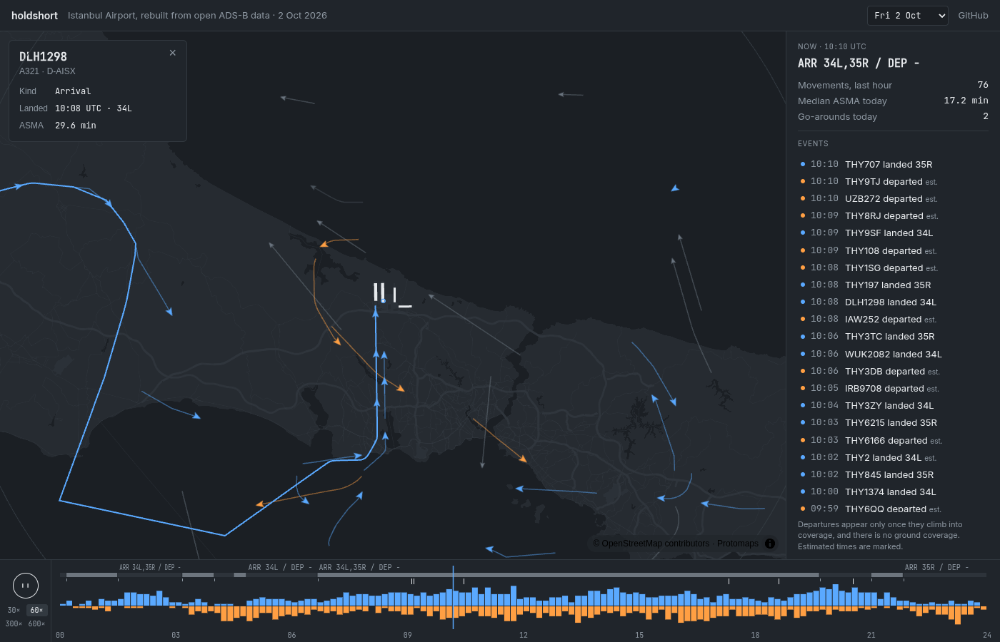
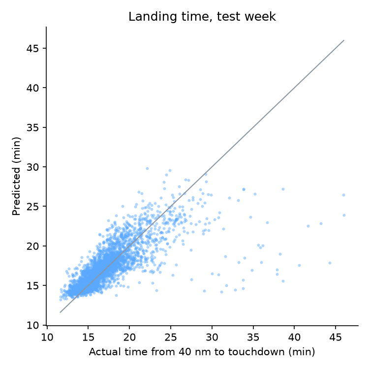
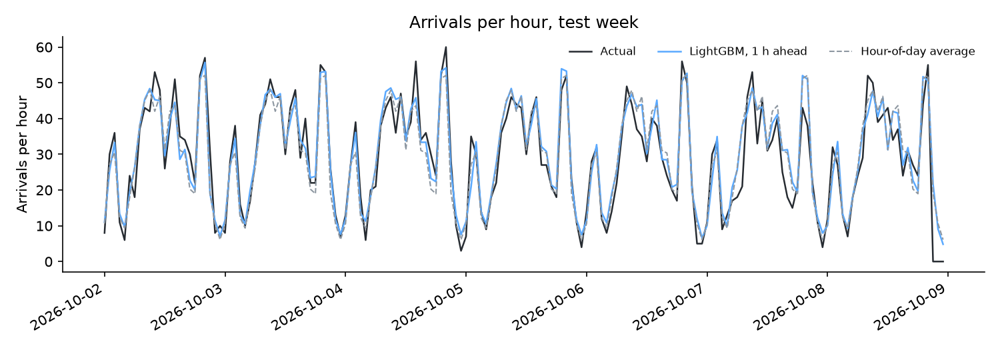
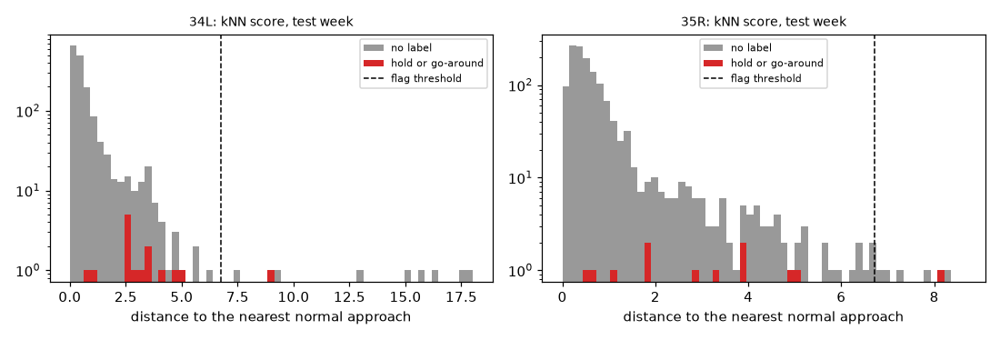
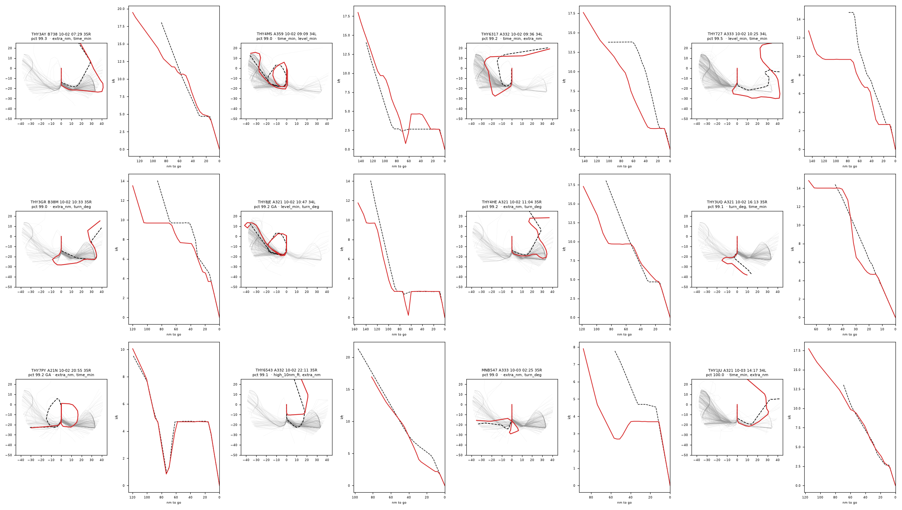

# holdshort: rebuilding Istanbul Airport from open ADS-B data

holdshort is a digital twin of the airspace around Istanbul Airport, built only from open data. It
collects every aircraft position within 50 nautical miles, works out which flights landed or took
off, on which runway and when, replays any day in the browser, forecasts landing times, and looks
for unusual approaches. This is a write-up of how it works, what the results are, and where it fell
short.


*Every position recorded within 50 nm of Istanbul Airport on 2 October 2026. Blue: arrivals; orange: departures; grey: everything else. The bright loops are the approach patterns into runways 34L and 35R.*

| Question | Result |
| --- | --- |
| Movements per day, against the airport operator's published average | 1,282, which is −11.5% |
| Time from 40 nm to touchdown, mean error | 1.39 min, against 1.90 min for the best baseline |
| Arrivals per hour, 1–3 hours ahead | no better than "same hour, last 7 days" (3.82) |
| Finding holds and go-arounds without being told (average precision) | 0.105 for my detector, 0.496 for a simpler one |

Live replay: [holdshort.pages.dev](https://holdshort.pages.dev). Code: [github.com/iliev-blnk/holdshort](https://github.com/iliev-blnk/holdshort). Full reports: [forecasting](https://github.com/iliev-blnk/holdshort/blob/main/research/REPORT.md) and [anomaly detection](https://github.com/iliev-blnk/holdshort/blob/main/research/ANOMALY.md).

## Why an airport

I wanted one project that covers the whole path from raw data to a product: ingest, a rules
engine, a user interface, machine learning and serving. An airport suits that well. The data is
open: aircraft broadcast their position several times a second over ADS-B (Automatic Dependent
Surveillance–Broadcast), and volunteer receivers share it. The problem has real structure,
because runways, approach procedures and weather all constrain what aircraft can do. And there
are published figures to check against: DHMI, the Turkish airport operator, publishes monthly
movement counts.

Istanbul (ICAO code LTFM) is one of the busiest airports in Europe, about 1,450 movements a day,
with several parallel north–south runways. Suceava (LRSV), a small airport in Romania, runs alongside it
as a second, quiet test case.

The project has six parts, built in this order:

1. **Ingest:** every position within 50 nm, as Parquet, with weather.
2. **Twin:** positions turned into flights and airport events.
3. **Console:** a browser replay of any day.
4. **Research:** two forecasts against honest baselines, served from Rust.
5. **Anomaly detection:** unusual approaches, found without labels.
6. **This write-up.**

```
 adsb.lol daily archive (GitHub, ~4 GB/day) ──► backfill ─┐
 adsb.lol / OpenSky live APIs ─────────────────► live ────┤
 METAR weather (aviationweather.gov, IEM) ─────► weather ─┤
                                                          ▼
                                     compact → obs.parquet per airport-day
                                                          │
                                twin (Rust) → flights, events, runway bins
                                     │                    │
                     features (Rust) │                    └─► export → console (static site)
                                     ▼                                  ▲
                 research (Python: LightGBM, kNN) → models/ (ONNX, f32) ┘
                                     │
                     models crate (Rust) → forecast-check, anomaly-check, export
```

## Getting the data

The first version ran in the cloud: a Cloudflare Worker polled a free live ADS-B API every 10
seconds and stored positions in a database. It never worked. From Cloudflare's network, adsb.lol
answered with HTTP 429, airplanes.live and adsb.fi with 403, and OpenSky timed out. Every free API
I tried rate-limits or blocks data-centre traffic.

So the dataset is built history-first. adsb.lol publishes a daily archive of everything its
feeders saw, as a tar file of about 4 GB on GitHub. `holdshort backfill` streams that file without
writing it to disk, keeps only the positions inside each airport's circle, and writes one
compressed file per airport and day. One day for Istanbul comes to about 160,000 positions from
1,100 aircraft. It takes about 7 minutes and 40 MB of memory. GitHub's CDN resets long downloads,
so the stream resumes with HTTP Range requests where it broke off.

A live poller (`holdshort live`) still exists for same-day data. It runs on my machine, polls on a
fixed 10-second grid, falls back to OpenSky after two failed polls, and writes a status line for
every poll, so gaps are recorded as data rather than discovered later. `holdshort compact` merges
the two sources per day: the archive wins in any hour it covers, and live data fills the rest.

The archive has a catch I only found later: it is thinned. Most points are about 5 seconds apart,
but on straight legs points are dropped, so gaps of three minutes on a straight line are normal.
That shaped several rules further down, which treat gaps of up to 10 minutes as thinning rather
than lost coverage.

The dataset used for everything below is 38 days, 1 September to 8 October 2026.

## The twin: from positions to an airport

The twin turns a day of positions into flights and events: arrivals and departures with their
runway and time, go-arounds (an aborted landing followed by another approach), holds (circling
while waiting to land), the time each arrival spent from 40 nm to touchdown, and the runway
configuration in use. It is pure Rust with no I/O, so it also compiles to WebAssembly.

The rules are simple to state. A flight is an arrival when at least three of its points line up
with a runway's extended centreline below 2,000 ft and the last one is below 1,500 ft. The runway
is the one with the smallest mean cross-track distance. The touchdown time is extrapolated from the
last point's ground speed and its distance to the runway. Heights come from barometric altitude
corrected with the airport's pressure setting from the METAR weather report.

Most of the work was in what the data does not show:

- **There is no ground coverage.** Arrivals are tracked down to about 300 ft. Departures are
  usually first seen at about 11,000 ft, 12 nm out. They are recognised by their climb away from
  the airport, but their runway is almost never known (12 of 5,712).
- **The runway data was wrong.** OurAirports, the public runway database, gives Istanbul's
  north–south runways a heading of 354° where the line through the two thresholds is 359°. With
  those headings almost no landing matched the right-hand runways. The twin now derives every
  heading from the threshold positions.
- **Approaches get lost on final.** Coverage near runway 36 ends around 2,000 ft. I added a rule
  for it: a track that ends lined up with a runway, still descending, below 2,500 ft and within
  10 nm counts as an arrival, with its touchdown time marked as low confidence. As a check, 83% of
  these aircraft depart Istanbul again within 24 hours, against 86% of the other arrivals.

To judge the result, `holdshort twin-check` compares it with public figures and plausibility bounds.
Over 10 days (29 September to 8 October):

| Check | Result | Bar |
| --- | --- | --- |
| Movements per day | 1,282 (−11.5% vs DHMI's 1,449) | ±15% |
| Arrivals with a clear runway | 99.9% | ≥ 95% |
| Landings with a tailwind of 5 kt or less | 92.5% | ≥ 90% |
| Go-arounds per 1,000 arrivals | 5.1 | 0.5–10 |
| Median time from 40 nm to touchdown | 16.8 min | 5–25 min |

Most of the 11.5% shortfall is coverage: the twin finds about 20% fewer departures than arrivals,
which matches departures that never come into view. Suceava is
the extreme case. In 10 days no aircraft was seen below 14,800 ft within 47 nm of it, so every one
of its flights is an overflight. A local receiver would fix that, and I have not built one.

## A replay in the browser

The console replays any of the exported days: aircraft move on the map in their kind's colour
with short trails, a timeline shows movements per 10 minutes and the runway configuration, the
side panel lists events as they happen, and clicking an aircraft opens its flight. The URL keeps
the day, the time and the selected flight, so a moment can be linked.



*The console replaying 2 October 2026: a selected arrival, the event feed, and the timeline with the runway configuration.*

It is a static site on Cloudflare Pages with no server. `holdshort export` writes each day as a
JSON file of flights and events, plus every position as little-endian columns that the browser
reads straight into typed arrays, about 1.9 MB gzipped per day. The map is MapLibre with deck.gl
layers on top; positions are interpolated between points, and an aircraft disappears in coverage
gaps longer than five minutes instead of flying a straight line through them.

Two hosting details cost time. Pages ignores HTTP Range requests, so the single-file map format
(PMTiles) does not work; the basemap is unpacked into plain tile files instead. And Pages serves
the app's `index.html` for any missing file, including missing map tiles, unless a `404.html`
exists.

## Forecasting with honest baselines

Two questions, both about arrivals:

1. When an aircraft first comes within 40 nm, how long until it lands? This is the time an arrival
   manager has to plan with.
2. At the top of each hour, how many aircraft will land in each of the next three hours?

The rules were fixed before training. Days are split in time order, never at random: 24 days to
train, 7 to tune, and the last 7 (2–8 October) for the test, scored once. Every model is compared
with simple baselines, and is called better only if it beats the best of them on the test week.
The features are computed in Rust, inside the twin, and Python only trains on them. The trained
LightGBM models are exported to ONNX and run from Rust with ONNX Runtime, and parity tests check
that Rust reproduces Python's predictions.

**Landing time.** The model's mean error is 1.39 min. The best baseline, the median time for each
entry direction and runway configuration, has 1.90 min, and a single global median has 2.44 min.
The model is better on every test day and in every traffic band, and the gain is largest when the
approach is busy.



*Predicted against actual time from 40 nm to touchdown on the test week.*

One bug is worth telling. The first version took each arrival's features from the point nearest
the 40 nm crossing. In 28% of rows that point was after the crossing, which means the model saw a
little of the future. The final review caught it; features now come from the last point at or
before the crossing.

**Arrivals per hour.** This one did not work. One hour ahead, the model's error is 3.93 arrivals
per hour; the average of the same hour over the last seven days gets 3.82. At two and three hours
the model is ahead by 0.01 and 0.05, which is not a real difference. Istanbul is a hub, and its
schedule repeats from day to day, so the recent same-hour average already holds most of what
positions alone can predict. Beating it would need schedule data, which the project does not use.



*Arrivals per hour on the test week: actual (black), the model one hour ahead (blue) and the hour-of-day average (dashed).*

## Looking for unusual approaches

The last part asks which approaches were unusual, without saying what unusual means. Each
approach from 40 nm to touchdown is resampled at 32 points equally spaced along its path, in its
runway's frame. Its score is the distance to the most similar normal approach to the same runway,
where normal means the training days' approaches without a hold or go-around. The top 1% are
flagged, and the console shows each flagged approach with its nearest normal one dashed next to
it and the measures that stand out, such as extra distance flown or time level below 10,000 ft.

I chose this nearest-neighbour detector before seeing the test results, because it explains each
flag with a real approach. To check it, I used the holds and go-arounds the twin finds with its
own rules, and compared it with three other detectors.

| Detector | Average precision | Recall in the top 1% |
| --- | --- | --- |
| Nearest normal path (shipped) | 0.105 | 0.107 |
| Robust z-score on seven measures | 0.071 | 0.000 |
| Isolation forest on the same measures | 0.423 | 0.643 |
| Landing-time error of the forecast model | 0.496 | 0.643 |

A random ranking scores about 0.009. The shipped detector is the weakest of the useful ones at
finding holds and go-arounds. Those are mostly long approaches, and the other detectors measure
length and time directly.



*Nearest-path scores on the test week, with holds and go-arounds in red and the flag threshold dashed.*

**A correction.** The first test run gave 0.208. The code review after it found a coverage bug:
when the last point before the 40 nm entry was more than 10 minutes before the next one, the
entry was interpolated across that gap, sometimes from an earlier flight of the same aircraft. The
fix removed 69 of 15,245 approaches and halved the score. I kept the fix and report the lower
number, with the first one alongside it. That so small a change moves the result this much also
says how few labels there are: 28 in the test week.

**What it flags instead.** I looked at each of the 19 flagged test approaches. 13 entered the
40 nm ring from the north or north-east, a route only 1.0% of normal approaches take; one flight
is flagged on two days at the same time. Four are go-arounds, and one of those the twin's rule
missed. The same check found 22 more unlabelled go-around shapes among the "normal" approaches,
which explains part of the detector's low score: go-arounds the rule misses stay in the reference
and give the labelled ones close neighbours.

[](writeup-figures/anomaly_gallery_1.png)

*Flagged test approaches in red, over a sample of normal ones in grey, with the nearest normal approach dashed and the height profile beside each. Select the image for full size.*

One more correction came from the data itself. Approaches to runway 34L sat about 500 ft below a
3° glide path at 10 nm, with almost no spread. I first put that down to a wrong threshold position
in the runway data. The reviewer checked the heights: at 10 nm, most 34L traffic is still level at
3,000 ft and joins the glide path closer in. The report now says that.

## What I would do differently

- **Fix the labels before using them.** The twin's go-around rule misses some go-arounds. I used
  its output as the check for the anomaly detector, which tested the detector against an
  incomplete answer key.
- **Write down the evaluation before the first test run,** including the coverage rules, so a
  later bug fix cannot look like tuning, even when it lowers the number.
- **Put up a receiver.** A local ADS-B receiver near Suceava, and one with a view of Istanbul's
  runways, would add ground movements, departures from the runway and the approaches now lost on
  final. Most of the twin's limits are coverage, not logic.
- **Add schedules** before trying the hourly forecast again.

What held up:

- **A pure core.** The rules in `core` and `twin` have no I/O. They are tested with synthetic
  tracks whose answer is known, and they build for WebAssembly.
- **One source of truth for features.** Rust computes them for training and for serving.
- **Parity tests between Python and Rust**, and commands that reproduce every reported number.

## Engineering notes

The repository has about 10,300 lines of Rust, 2,000 of Python and 2,100 of TypeScript:

- `crates/core`: record types, feed parsers, airports, coverage. No I/O; builds for WebAssembly.
- `crates/twin`: flights, runways, events, configuration, forecast features and approach rows.
  Pure; builds for WebAssembly.
- `crates/models`: the ONNX models through `ort`, and the approach detector in plain Rust.
- `crates/cli`: the `holdshort` binary (backfill, live, compact, twin, features, export and the
  check commands).
- `research/`: Python with polars, LightGBM and scikit-learn. It trains, compares against
  baselines and writes the reports.
- `console/`: Vite, TypeScript, MapLibre and deck.gl. This page is rendered from the repository's
  `docs/WRITEUP.md` by the same build.

CI runs three jobs on every push:

- Rust: format, clippy, tests and the WebAssembly build.
- Python: tests on synthetic data.
- Console: type check, unit tests, build and a browser test of a small fixture day.

Two decisions about tooling saved time. `tract`, a pure-Rust ONNX runtime, could not run the tree
ensembles LightGBM exports, and scikit-learn's gradient-boosting converter broke on the current
ONNX release. LightGBM exported through `onnxmltools` and run with ONNX Runtime matched Python to
within 1e-6. The anomaly detector is a few loops over a float array, so it skips ONNX and runs in
plain Rust, with the same parity tests.

Every number above can be reproduced from the repository:

```sh
holdshort backfill      2026-09-01..2026-10-08 --airport LTFM
holdshort metar-history 2026-09-01..2026-10-08 --airport LTFM
holdshort compact       2026-09-01..2026-10-08 --airport LTFM
holdshort twin          2026-09-01..2026-10-08 --airport LTFM
holdshort twin-check    2026-09-29..2026-10-08 --airport LTFM
holdshort features      2026-09-01..2026-10-08 --airport LTFM
(cd research && .venv/bin/python -m holdshort_research all --data ../data --out ../models --report .)
holdshort forecast-check 2026-10-02..2026-10-08 --airport LTFM
holdshort anomaly-check  2026-10-02..2026-10-08 --airport LTFM
```

Data comes from [adsb.lol](https://adsb.lol) (ODbL; feeder contributions CC0), the
[OpenSky Network](https://opensky-network.org), [aviationweather.gov](https://aviationweather.gov)
and the [Iowa Environmental Mesonet](https://mesonet.agron.iastate.edu). The basemap is from
[Protomaps](https://protomaps.com) and [OpenStreetMap](https://www.openstreetmap.org/copyright).
The code is MIT-licensed.
