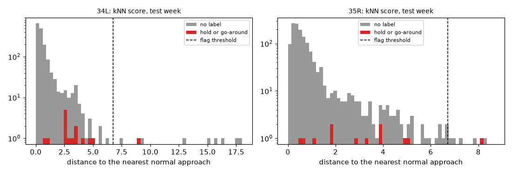
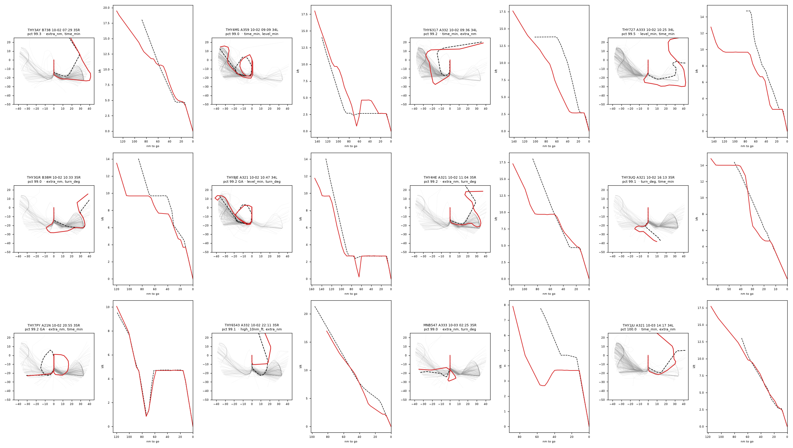
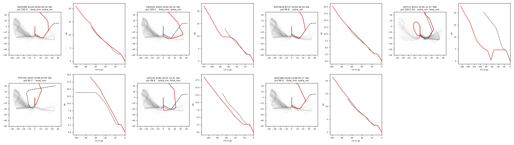

# Approach anomaly detection

Which approaches into Istanbul were unusual? Every arrival is compared with the normal approaches flown to the same runway, from the 40 nm ring to touchdown. The top 1% are flagged. Nothing in the detector knows what a hold or a go-around is; those events, found by the twin's rules, are used only to check it.

## Data

Approach rows from `holdshort features`: 15,176 scored approaches to 34L and 35R (train 9,008, validation 3,137, test 3,031). An approach is scored when it has a 40 nm entry, a confident touchdown, at least 20 points and no gap over 10 minutes. Unscored over the 38 days: no entry 6,127, lost on final 5,348, coverage 200, runway 81.

The reference is the training days' approaches without a hold or go-around: 34L 4,720, 35R 4,206.

Each approach is resampled at 32 points equally spaced along the path, in its runway's frame (nm along and across the centreline, height in thousands of feet).

## Detectors

- **kNN path distance (served).** The mean distance to the k nearest reference approaches. The distance between two approaches is the mean over the 32 points of the distance in (x, y, h). k = 1 was chosen on the validation week (AP by k: 1: 0.115, 5: 0.093, 10: 0.086, 20: 0.068). It was fixed as the served detector before the test week was scored, because it explains each flag with a real approach.
- **Robust z.** The largest |z| over seven metrics (extra distance, time, turns, level time, height at 10 nm, speed at 4 nm, cross-track on final), against the reference median and MAD.
- **Isolation forest** on the same seven metrics.
- **Landing-time residual.** |actual − predicted| from the sub-project 4 model at 40 nm.

## Results on the test week (2–8 October 2026)

3,031 approaches, 28 of them with a hold or go-around. Ranking all approaches by each detector's score:

| Detector | Average precision | Recall in the top 1% |
| --- | --- | --- |
| kNN path distance (served) | 0.105 | 0.107 |
| Robust z (max over metrics) | 0.071 | 0.000 |
| Isolation forest on metrics | 0.423 | 0.643 |
| Landing-time residual (sub-project 4) | 0.496 | 0.643 |

A random ranking would have an average precision of about 0.009.

Robust z is held back by two nearly constant metrics. On 34L most aircraft are still level at 3,000 ft at 10 nm, so the spread of the height at 10 nm is a few feet, and cross-track on final varies by a few metres on both runways. Tiny differences there give huge z values: in 31 of the 31 top robust-z approaches the largest |z| is one of those two metrics. The reasons shown in the console therefore divide by at least a floor per metric (100 ft, 50 m, 5 kt, …); the robust-z detector above is scored as it was fitted.

**The served kNN detector is not the best at finding holds and go-arounds.** Landing-time residual (sub-project 4) ranks them higher. Holds and go-arounds are mostly long approaches: extra distance and extra time, which the metric detectors and the landing-time residual measure directly. The kNN distance compares shapes along the path, and resampling by distance squeezes a long hold into a short stretch of the path. The detector was fixed before the test week, so it stays; the review below shows what it does flag.

**A correction after the first test run.** The first run scored 3,050 test approaches with k = 5: kNN average precision 0.208, recall 0.393, 22 flagged. The final code review then found a coverage bug: when the last point before the 40 nm entry was more than 10 minutes before the first point after it, the entry was interpolated across that gap (sometimes from an earlier flight of the same aircraft). Such approaches now count as coverage gaps, as the 10-minute rule intends. That removed 69 of the 15,245 scored approaches (0.5%), the validation week then chose k = 1 instead of 5, and the numbers above are from the corrected pipeline. Nothing else changed, and the fix was not chosen for its effect: it lowered the kNN numbers. That so small a change moves them this much is itself a result: with 28 labelled test approaches, the kNN numbers are fragile.

With the threshold from the validation week, kNN flagged 19 test approaches (0.6%). Labelled approaches had a median kNN percentile of 94.2.

Per test day (kNN):

| Day | Approaches | Labelled | Flagged | AP | Recall in top 1% |
| --- | --- | --- | --- | --- | --- |
| 2026-10-02 | 479 | 11 | 10 | 0.122 | 0.091 |
| 2026-10-03 | 476 | 6 | 2 | 0.208 | 0.167 |
| 2026-10-04 | 425 | 4 | 3 | 0.160 | 0.000 |
| 2026-10-05 | 465 | 2 | 1 | 0.548 | 0.500 |
| 2026-10-06 | 407 | 0 | 1 | – | – |
| 2026-10-07 | 357 | 0 | 1 | – | – |
| 2026-10-08 | 422 | 5 | 1 | 0.188 | 0.000 |

## What the detector flags

Every flagged test approach is drawn below (red) over a sample of the reference approaches (grey), with its nearest normal approach dashed, and its height against distance to go. Each was put in a category by looking at the drawing; the categories are the author's judgement, not ground truth.

| Category | Approaches |
| --- | --- |
| entry from the north or north-east | 13 |
| go-around (twin label) | 3 |
| unusual routing | 2 |
| go-around the twin missed | 1 |

Most of the unlabelled flags entered the ring from the north or north-east. Only 1.0% of the reference approaches did, so the detector finds them far from everything it knows. The traffic flow is real but rare: WZZ398 is flagged twice, each time at the same time of day.

The review also explains why kNN ranks go-arounds lower than the other detectors. 22 of the 8,926 reference approaches have a go-around shape in their resampled height profile (below 1,500 ft, then above 3,000 ft) but no twin label, and one flagged test approach is the same (a go-around the twin missed). Go-arounds the twin's rule misses stay in the reference and give the labelled go-arounds close neighbours.

| Flight | Day | Category | Note |
| --- | --- | --- | --- |
| THY6317 | 2026-10-02 | entry from the north or north-east | entered at 62°, crossed north of the airport and came down the west side; +100 nm |
| THY3UQ | 2026-10-02 | unusual routing | entered from the south (165°), crossed under the final to the west and joined at 17 nm |
| THY727 | 2026-10-02 | entry from the north or north-east | entered at 53°, east downwind out to 28 nm south, level at 9,700 ft for about 40 nm |
| THY6543 | 2026-10-02 | entry from the north or north-east | entered at 8°, short join to final at 8 nm, 1,000 ft below a 3° path at 10 nm |
| THY4HE | 2026-10-02 | entry from the north or north-east | entered at 62°, wide east downwind |
| THY8JE | 2026-10-02 | go-around (twin label) | go-around and hold |
| THY3AY | 2026-10-02 | entry from the north or north-east | entered at 13°, round the east side, joined final at 17 nm; +89 nm |
| THY3GR | 2026-10-02 | entry from the north or north-east | entered at 67°, east side out to 28 nm south, joined at 12 nm |
| THY4MS | 2026-10-02 | go-around the twin missed | descends to about 800 ft, climbs back to 4,600 ft and lands from a second approach; no twin label |
| THY7PY | 2026-10-02 | go-around (twin label) |  |
| THY1JU | 2026-10-03 | entry from the north or north-east | entered at 4°, wide east downwind |
| MNB547 | 2026-10-03 | unusual routing | night cargo from the west: descended early to 2,700 ft, crossed the final south of the airport, S-turned and climbed back to 3,700 ft before joining at 17 nm |
| WZZ398 | 2026-10-04 | entry from the north or north-east | entered at 4°, east side, joined at 13 nm; the same flight is flagged at the same time on 10-08 |
| ROT261N | 2026-10-04 | entry from the north or north-east | entered at 6°, east side, joined at 13 nm |
| FIA5325 | 2026-10-04 | entry from the north or north-east | entered at 4°, wide east downwind, level at 9,700 ft |
| BTI711 | 2026-10-05 | go-around (twin label) | also entered from the north |
| THY7AZ | 2026-10-06 | entry from the north or north-east | entered at 4°, cut straight to an 11 nm final, higher than normal on the way |
| LOT135 | 2026-10-07 | entry from the north or north-east | entered at 4°, wide east downwind, joined at 21 nm |
| WZZ398 | 2026-10-08 | entry from the north or north-east | entered at 4°, east side, joined at 13 nm |

## Emergency squawk

IHAEM381 (4b8061) squawked 7700 on 2026-10-05. The twin classed it as overflight, so it has no approach score.

## Limitations

- The labels only cover large deviations (holds and go-arounds) found by the twin's own rules, so the numbers above say how well each detector finds those. Anything else the detector finds rests on the review.
- The labels are also used to keep holds and go-arounds out of the reference.
- North flow only: every day in the data landed on 34L/35R. South-flow approaches and the other runways are not scored.
- Coverage holes can look like unusual approaches. Lost-on-final arrivals (20% of arrivals) are not scored at all.
- At 10 nm, most 34L traffic is still level at 3,000 ft (about 500 ft below a 3° path) and joins the glide path closer in, while 35R traffic is already on it. The height at 10 nm therefore means different things on the two runways; per-runway statistics keep them apart.

To reproduce: `holdshort features 2026-09-01..2026-10-08`, then `python -m holdshort_research approach --data ../data --out ../models --report .`, then `holdshort anomaly-check 2026-10-02..2026-10-08`.
