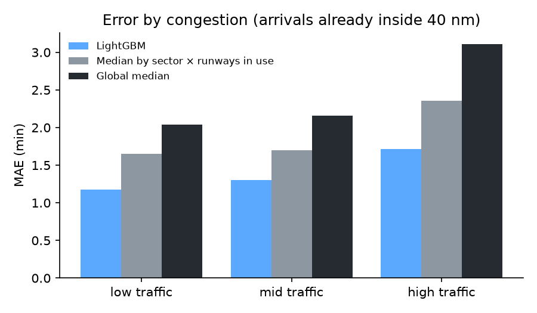
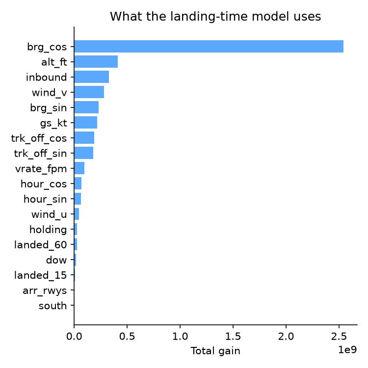

# holdshort research: two short-term forecasts for Istanbul Airport

Generated by `python -m holdshort_research all` from the twin's feature tables
(`holdshort features`). Days are split in time order: train 2026-09-01..2026-09-24,
validation 2026-09-25..2026-10-01 (tree count), test 2026-10-02..2026-10-08
(scored once). Final models are refit on train + validation. Rows: 9106 train,
3208 validation, 3143 test arrivals.

## Landing time at 40 nm

When an arrival first comes within 40 nm of LTFM, how long until it lands? This is the ASMA time
(Eurocontrol's Arrival Sequencing and Metering Area) that an arrival manager has to plan.

| Predictor | MAE (min) | RMSE (min) | P90 error (min) |
| --- | --- | --- | --- |
| **LightGBM** | 1.39 | 2.45 | 2.69 |
| Global median | 2.44 | 3.72 | 4.92 |
| Median by sector × runways in use | 1.90 | 3.08 | 3.81 |
| Distance ÷ ground speed (scaled) | 3.31 | 4.65 | 7.63 |

The model's mean error is **1.39 min** against **1.90 min** for the best
baseline (Median by sector × runways in use), 27% lower.

By congestion (arrivals already inside the ring when the flight enters: low ≤ 6, mid ≤ 9,
high above, cut at the training terciles):

| Traffic | Flights | LightGBM MAE (min) | Sector × runways (min) | Global median (min) |
| --- | --- | --- | --- | --- |
| low | 1238 | 1.18 | 1.65 | 2.04 |
| mid | 835 | 1.30 | 1.70 | 2.16 |
| high | 1070 | 1.71 | 2.35 | 3.11 |

By test day:

| Day | Flights | LightGBM MAE (min) | Best baseline MAE (min) |
| --- | --- | --- | --- |
| 2026-10-02 | 492 | 1.99 | 2.83 |
| 2026-10-03 | 479 | 1.40 | 1.89 |
| 2026-10-04 | 435 | 1.31 | 1.82 |
| 2026-10-05 | 485 | 1.24 | 1.62 |
| 2026-10-06 | 418 | 0.97 | 1.49 |
| 2026-10-07 | 402 | 1.16 | 1.50 |
| 2026-10-08 | 432 | 1.59 | 2.03 |

## Arrivals per hour

At the top of each hour, how many arrivals will land in each of the next three hours? Mean
absolute error in arrivals per hour on the test week:

| Horizon | LightGBM MAE | Last hour | Same hour yesterday | Hour-of-day average |
| --- | --- | --- | --- | --- |
| 1 h | **3.86** | 10.74 | 4.67 | 4.17 |
| 2 h | **3.79** | 16.53 | 4.67 | 4.17 |
| 3 h | **3.80** | 17.38 | 4.67 | 4.17 |

One hour ahead the model's error is 3.86 arrivals per hour against 4.17
for the best baseline (Hour-of-day average).

## Limitations

- **One airport, 7 test days, about five weeks in all.** No seasonal or
  schedule changes are in the data, and there is one week of test. The numbers say how well this
  works on these weeks, not across a year.
- **Coverage.** The twin only knows what the open ADS-B feeders see. Arrivals whose touchdown
  time was estimated (lost on final) are left out of the landing-time rows. Coverage also got
  worse on 6–8 October, inside the test week.
- **`inbound` is slightly optimistic.** It counts aircraft inside 40 nm that later land; a live
  system sees the same aircraft but cannot be certain each one will land.
- **No schedules or flight plans.** Everything comes from positions, METAR and the twin's own
  events. An operational arrival manager also knows the planned sequence and the runway in use
  ahead of time.
- **Hourly counts are touchdowns the twin detected**, not official movements (about 10% below
  DHMI's published averages).
